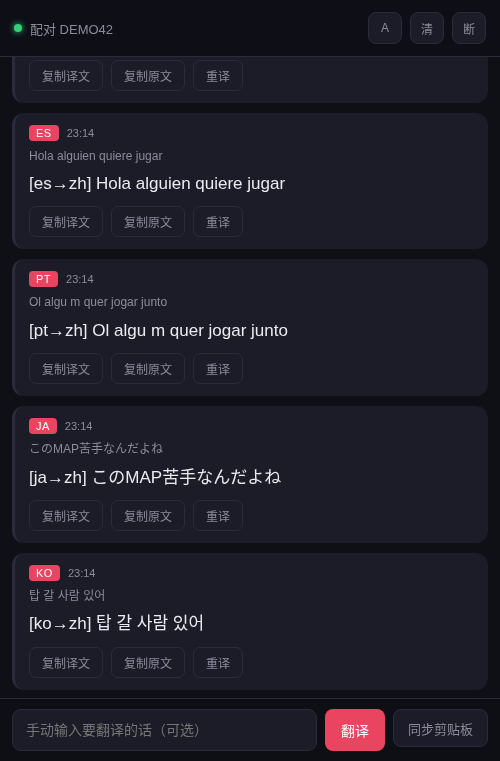
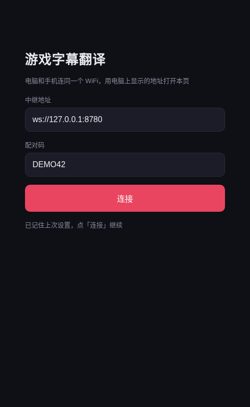

# 外服游戏实时翻译（局域网版）

外服游戏里外国人说的话 → PC 端截屏 OCR → 本地语种识别 → 翻译 → **PC 顶部字幕条** + **手机网页字幕流**，双向剪贴板同步。全部在同一个 WiFi 内跑通，**不需要公网、不需要云服务器、不需要 VPN**。

<p align="center">
  
  
</p>

---

## 一、它做什么

| 环节 | 实现 |
|---|---|
| 抓字 | 圈选游戏聊天框区域，每 1.5 秒截图，RapidOCR 识别成文本行（多语种，不碰游戏内存，不会触发反作弊） |
| 识别语种 | 本地 lingua，13 种语言，纯离线，不联网 |
| 翻译 | 4 种引擎可选：mock（测试）/ argos（本地离线）/ DeepL / 阿里云千问 |
| PC 显示 | 屏幕底部一条半透明字幕，置顶、鼠标穿透，不挡游戏操作 |
| 手机显示 | 手机网页实时字幕流，带语种标签、时间、复制译文/原文、重译 |
| 剪贴板 | PC 复制 → 手机剪贴板；手机复制 → PC 剪贴板（自动去重，防回环） |

---

## 二、三步跑起来（Windows）

### 1. 装依赖（只需一次）
双击 **`install.bat`**，或手动：
```bat
python -m pip install -r requirements.txt
```

### 2. 圈选游戏聊天区域（只需一次，换游戏再圈）
1. 先把游戏切到窗口化 / 无边框窗口，让聊天框可见
2. 双击 **`select_region.bat`**，屏幕变暗后**拖拽框住聊天框**，回车确认
   - 取消按 `Esc`
   - 没图形界面时，直接改 `config.json` 的 `region: [x, y, 宽, 高]`

### 3. 启动
双击 **`start.bat`**。终端会打印：

```
========================================================
  游戏聊天实时翻译  ·  局域网模式
========================================================
  配对码      : 3F8A2C
  翻译引擎    : mock   目标语言: zh
  OCR 来源    : screen   区域: [80, 480, 620, 200]
  中继地址    : ws://192.168.1.7:8780
  手机端地址  : http://192.168.1.7:8781/
========================================================
  [二维码]
  手机扫码直接打开（需与电脑同一 WiFi）
========================================================
```

手机连**同一个 WiFi**，扫码（或手动打开那个地址），页面会自动填好中继地址和配对码并连接。

---

## 三、配置 `config.json`

首次启动自动生成，改完重启生效。

| 字段 | 默认 | 说明 |
|---|---|---|
| `pair` | 自动生成 | 配对码；想固定就自己写 6 位字母数字 |
| `translator` | `mock` | **改成 `argos` / `deepl` / `qwen` 才会真的翻译** |
| `deepl_key` | 空 | DeepL API Key（免费版以 `:fx` 结尾自动走 free 域名） |
| `qwen_key` | 空 | 阿里云百炼 API Key（qwen-turbo，OpenAI 兼容协议） |
| `target_lang` | `zh` | 目标语言 |
| `ocr_source` | `screen` | `screen` 真实截图；`demo` 用内置样例（不截图，验证链路用） |
| `region` | `[80,480,620,200]` | 聊天框圈选区域 `[x, y, w, h]` |
| `poll_interval` | `1.5` | 截图间隔（秒）；越小越实时，越吃 CPU |
| `dedup_window` | `8.0` | 同一句话多少秒内不重复推送（防聊天框重绘刷屏） |
| `overlay` | `true` | PC 字幕条开关；觉得挡画面就设 `false` |
| `overlay_font` | `22` | 字幕字号 |
| `subtitle_ttl` | `8.0` | 字幕停留秒数 |
| `relay_port` / `phone_port` | `8780` / `8781` | 被占用会自动顺延并在终端提示 |

### 选哪个翻译引擎

| 引擎 | 联网 | 花钱 | 质量 | 适合 |
|---|---|---|---|---|
| `argos` | 仅首次下模型 | 免费 | 中等 | 想完全离线、不想给 API 付费 |
| `deepl` | 是 | 按量计费（有免费额度） | 最好 | 追求翻译质量 |
| `qwen` | 是 | 按量计费（很便宜） | 好 | 国内网络稳定、支持小语种上下文 |
| `mock` | 否 | 免费 | 只加前缀不翻译 | 只想验证链路是否通 |

> `argos` 首次使用会后台下载语言包（每个语言对约 100MB，只在第一次），下载期间该语种先显示原文，装好自动生效，不会卡住流水线。

---

## 四、手机端功能

- 每行字幕：语种标签（EN/JA/KO/RU/DE/FR/ES/PT 等）+ 时间
- **复制译文** / **复制原文** / **重译**（重译会把该条原文发回 PC 重新翻译）
- 底部：手动输入一句话点「翻译」（不必等 OCR 抓）
- 「同步剪贴板」：把手机剪贴板内容发到 PC
- 「A」切字号、「清」清空列表、「断」断开连接
- 扫码进入时自动带参数、自动连接；手动进入会记住上次设置

---

## 五、Windows 防火墙（连不上先看这里）

首次启动 Windows 会弹窗询问是否允许 Python 访问网络，**专用网络必须勾选允许**。
没弹窗就手动加：

`wf.msc` → 入站规则 → 新建规则 → 端口 → TCP → 本地端口 `8780,8781` → 允许连接 → 只勾「专用」→ 命名「游戏翻译」。

> 只开「专用（局域网）」就够了，不要勾「公用」，避免在公共 WiFi 上暴露端口。

---

## 六、目录结构

```
game-translator/
├── start.bat              一键启动（中继 + PC 流水线 + 手机服务 + 二维码）
├── install.bat            安装依赖
├── select_region.bat      圈选游戏聊天区域
├── config.example.json    配置模板
├── requirements.txt
├── relay/server.py        WebSocket 中继（配对码房间，只转发不落库）
├── lid/                   本地语种识别（lingua）
│   └── detector.py
├── pc/
│   ├── launch.py          一键启动入口
│   ├── main.py            只跑流水线（调试）
│   ├── config.py          配置 + 局域网 IP 探测
│   ├── ocr.py             截图 + RapidOCR + 行合并
│   ├── translator.py      mock / argos / deepl / qwen
│   ├── pipeline.py        去重 → 识别 → 翻译 → 推送
│   ├── clip.py            剪贴板读写 + 防回环
│   ├── relay_client.py    中继客户端（自动重连）
│   ├── overlay.py         tkinter 置顶字幕条（鼠标穿透）
│   └── select_region.py   拖拽圈选区域
├── phone/                 手机端网页（index.html / app.js / style.css）
└── examples/
    ├── test_lid.py        语种识别自检
    └── test_relay.py      中继路由联调
```

---

## 七、消息协议

| type | 方向 | 字段 |
|---|---|---|
| `hello` | C→S | `pair`, `role: pc/phone` |
| `paired` | S→C | `pair`, `peers` |
| `subtitle` | PC→手机 | `ts`, `lang`, `conf`, `src`, `trans`, `retry?`, `engine` |
| `clipboard` | 双向 | `text`, `from` |
| `translate_request` | 手机→PC | `src`, `lang`（重译/手动输入） |
| `status_request` / `status` | 手机↔PC | OCR 行数、已推送条数、引擎名 |

---

## 八、实现细节（为什么这么设计）

1. **只截屏，不读内存**：OCR 只对屏幕像素做识别，不注入游戏进程、不改游戏文件，主流反作弊（VAC/EAC/ACE）不会因此封号。
2. **视觉行合并**：OCR 输出的是一块块文本框，按 y 坐标容差 14px 聚成"一行"，行内按 x 排序拼接，避免同一行被拆成两段推送。
3. **去重靠归一化文本**：去掉标点/空格/大小写后做哈希，8 秒窗口内相同内容不重复推，解决聊天框滚动重绘导致的重复。
4. **语种判定兜底**：置信度 < 0.55（短文本 < 0.70）判 `unknown`；纯拉丁字母且 ≥3 字符按英文处理（游戏里拉丁短句绝大多数是英语）；"ok"/"gg"/"+1" 这类 ≤3 字符的判不出语种直接丢弃，不刷字幕。
5. **argos 不阻塞**：模型下载放后台线程，`translate()` 只读已安装的包，缺包时返回空串，上层保留原文，下一条自动生效。
6. **字幕条鼠标穿透**：Windows 下给窗口加 `WS_EX_LAYERED | WS_EX_TRANSPARENT`，点击直接落到下面的游戏。
7. **剪贴板防回环**：记住刚写入的远端内容，`poll_changed` 遇到它就跳过，不会 PC→手机→PC 无限循环。
8. **端口占用自动顺延**：8780/8781 被别的程序占了会自动换下一个，二维码和打印的地址用最终端口，不会给你印一个打不开的地址。

---

## 九、已验证 / 未验证

**已实测通过**
- 语种识别：15 条多语种聊天样例判定正确（ja/ko/ru/de/fr/es/pt/tr/ar/zh/en），短词兜底与噪声过滤生效
- OCR：RapidOCR 对合成聊天截图识别准确（置信度 0.98~0.99），三行文本按 y 合并正确（同行两段被合并成一句）
- 中继：PC↔手机双向字幕与剪贴板路由通过
- PC 流水线：demo 源 → 识别 → 翻译 → 推送，连续输出 14 条不同语种字幕无异常
- 手机端：真实浏览器连上中继后实时收到字幕，语种标签/复制/重译/底部手动输入均正常渲染
- 端口占用、断线重连、argos 缺包不阻塞：均验证

**未在本机验证（需要 Windows 实机）**
- 屏幕截图 OCR 的真实游戏画面效果（本机无显示器，`mss` 截图不可用；逻辑已用合成图验证）
- PC 字幕条的窗口置顶与鼠标穿透（tkinter 需要可见桌面）
- DeepL / 千问真实调用（本机网络到这两个域名被拦，代码为官方标准协议，填 key 即可）
- 中文/日文/韩文在 RapidOCR 中的识别率（本机测试图只有英文，模型本身支持中日韩但需真机截图校准 `ocr_min_score`）

---

## 十、常见问题

**手机连不上**
1. 确认手机和电脑同一个 WiFi（不要一个连 5G 一个连 2.4G 的不同网段，也不要电脑插网线到别的路由）
2. 电脑 IP 变了？重新看终端打印的地址
3. Windows 防火墙按上面第五节放行 8780/8781
4. 公司/学校 WiFi 开了"AP 隔离"，设备互访会被拦，换手机热点试

**识别不到文字**
1. 游戏必须窗口化 / 无边框，全屏独占模式下截图可能黑屏
2. 重新 `select_region.bat` 圈一次，框要完全覆盖聊天文字
3. 文字太小/太糊：游戏内把聊天字号调大，或把 `ocr_min_score` 降到 0.5

**字幕刷得太快 / 重复**
- 调大 `dedup_window`（如 15 秒）
- 调大 `poll_interval`（如 2.5 秒）

**字幕条挡视线**
- `overlay: false` 关掉，只看手机
- 或调小 `overlay_height` / `overlay_font`

---

## 十一、合规提醒

- 仅做屏幕截图识别，**不读游戏内存、不注入进程、不改游戏文件**。
- 部分游戏用户协议禁止第三方覆盖层，字幕条可随时用 `overlay: false` 关闭。
- 在线翻译会把聊天文本发到对应服务商，敏感场景请用 `argos` 本地翻译。
- 仅限个人使用，不要用于商业化分发或批量采集他人聊天内容。
