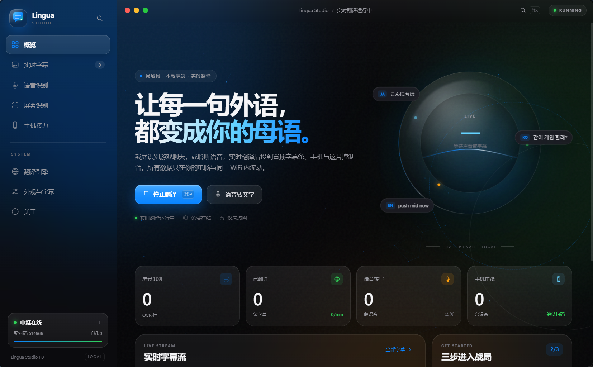
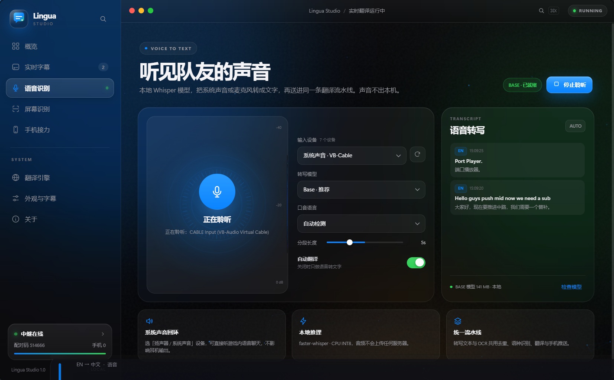
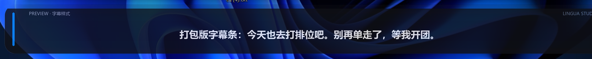

# Lingua Studio

> 外服游戏聊天实时翻译的桌面工作台。截屏 OCR、语音转文字、翻译、置顶字幕条、手机接力、双向剪贴板，全部在一个 Apple 风格的原生窗口里完成。

| 概览 | 语音识别 |
| --- | --- |
|  |  |



## 直接打开

- Windows 10/11，需要 **Edge WebView2 Runtime**（Windows 11 通常已内置）。
- 开发版：双击 `run.bat`（使用同目录上一级的 `.venv-studio`，无终端窗口）。
- 打包版：双击 `LinguaStudio.exe`。
- 也可以命令行运行：`.venv-studio\Scripts\python.exe app.py`（会输出日志，适合排查问题）。

首次启动需要一点时间初始化本地模型索引。右侧的状态灯从 `IDLE` 变成 `RUNNING` 就绪。

### 便携版安装

1. 把 `LinguaStudio-portable.zip` 解压到任意目录（建议路径不含中文、空格）。
2. **不要单独移动 `LinguaStudio.exe`**，它必须和同目录的 `_internal` 文件夹一起使用。
3. 双击 `LinguaStudio.exe` 即可。首次启动会创建 `data/`，配置、日志、OCR/Whisper 模型都放在这里。
4. 若系统缺少 WebView2，装一次微软的 [Edge WebView2 Runtime](https://developer.microsoft.com/microsoft-edge/webview2/)；Windows 11 与较新的 Windows 10 一般已自带。
5. 首次使用语音识别，在“语音识别”页选择设备并点“检查模型 / 准备模型”，`base` 模型约 141 MB，只下载一次。

便携包约 810 MB（含 WebView2 绑定、ONNX Runtime、OpenCV、RapidOCR 与语种识别运行时），压缩包会小一些；这是离线 OCR + 本地 Whisper 的完整运行时体积，不是安装器缓存。

## 八个页面

| 页面 | 能做什么 |
| --- | --- |
| **概览** | 一键启动/停止、能量球实时波形、翻译统计、字幕流、三步引导 |
| **实时字幕** | 全部/屏幕/语音/手动筛选，字幕卡、字幕条预览、字号/停留/透明度/圆角、手动输入一句话 |
| **语音识别** | 系统声音回环或麦克风、Whisper base、语言、分段长度、自动翻译、电平表、本地转写列表 |
| **屏幕识别** | 全屏截图圈选游戏聊天区域、区域预览、OCR 置信度/行距/语言、演示模式、识别框叠加 |
| **手机接力** | 二维码、配对码、中继地址、双向剪贴板；手机与电脑同一个 WiFi 即可 |
| **翻译引擎** | 免费在线（MyMemory）、通义千问、DeepL、Argos 离线、演示模式；目标语言网格；翻译试验场 |
| **外观与字幕** | 深空黑 / 晨光主题、强调色、粒子密度、减弱动效、字幕条参数、数据目录、日志导出 |
| **关于** | 版本、设计原则、隐私与合规说明 |

右上角 `⌘K`（Windows 上也可用 `Ctrl+K`）打开命令面板；`Esc` 关闭。

## 翻译与识别链路

1. **屏幕**：`mss` 截取圈选区域 → RapidOCR 多语种识别 → 置信度/去重过滤 → 语种识别 → 翻译 → 字幕流 + 置顶条 + 手机。
2. **语音**：`SoundCard` 采集系统回环或麦克风 → `faster-whisper` 本地转写 → 同一翻译流水线。音频不离开本机。
3. **手机**：本机 WebSocket 中继（默认 `8780`）+ 静态 PWA（默认 `8781`），只走局域网；手机可看字幕、重译、同步剪贴板。
4. **字幕条**：Win32 分层窗口，每像素透明、鼠标穿透、置顶、圆角玻璃、滑入淡出，不会挡住游戏操作。

## 配置

所有配置都在应用内改，立即保存到 `data/config.json`：

- 翻译：`translator`（`free` / `qwen` / `deepl` / `argos` / `mock`）、`target_lang`
- 屏幕：`ocr_source`（`screen` / `demo`）、`region`、`ocr_lang`、`ocr_min_score`、`ocr_line_gap`、`poll_interval`、`dedup_window`
- 语音：`asr_model`、`asr_device_id`、`asr_language`、`asr_chunk`、`asr_translate`
- 字幕条：`overlay`、`overlay_height`、`overlay_font`、`overlay_radius`、`subtitle_ttl`、`overlay_opacity`
- 手机：`pair`、`relay_port`、`phone_port`
- 外观：`theme`、`accent`、`particles`、`particle_density`、`reduce_motion`

免费在线翻译不需要 Key；通义千问/DeepL 在对应页面填入自己的 Key 后点“应用引擎”。Argos 为完全离线引擎，首次使用会下载语言包。

## 模型

- OCR：RapidOCR 自带中/英/日/欧洲语模型；韩/俄/阿拉伯等语言首次按需下载 10–20 MB。
- 语音：Whisper `base` 约 141 MB，首次下载走 `hf-mirror.com`；也可在语音页切换 `tiny` / `small`。
- 模型放在 `data/models`，可以整个目录备份或迁移。

## 隐私与合规

- 只截取屏幕像素，不读取游戏内存、不注入进程、不修改游戏文件。
- 语音识别完全在本机完成；音频不会上传。
- 在线翻译会把**当前要翻译的文本**发给对应服务商。敏感场景请切换到 Argos 离线引擎。
- 手机中继只在局域网内转发，不落库；断开即失效。
- 请遵守游戏与翻译服务商的条款。

## 开发 / 打包

```powershell
# 依赖
.venv-studio\Scripts\python.exe -m pip install -r requirements.txt

# 启动（有日志）
.venv-studio\Scripts\python.exe app.py

# 可选：PyInstaller 便携包（构建脚本见 tools\build_portable.ps1）
powershell -ExecutionPolicy Bypass -File tools\build_portable.ps1
```

项目结构：

```
app.py              pywebview 入口
ui/                 Apple 风格界面（HTML/CSS/JS）
pc/api.py           JS ↔ Python 桥
pc/runtime.py       服务生命周期
pc/pipeline.py      OCR / 翻译 / 字幕流水线
pc/asr.py           Whisper 语音转文字
pc/overlay.py       Win32 置顶字幕条
pc/phone_server.py  手机 PWA
relay/server.py     局域网 WebSocket 中继
phone/              手机端页面
lid/                语种识别
```

## 设计说明

界面采用 macOS / Apple 官网的视觉语言：`#f5f5f7` / `#1d1d1f` / `#0071e3`、18–28px 圆角、玻璃材质、弹簧曲线 `cubic-bezier(.22,1,.36,1)`、粒子与鼠标光晕、磁吸按钮、3D 卡片倾斜、能量球波形。它是 Windows 桌面应用，不是 macOS 安装包；这里的“Apple 风格”指设计语言与动效，不包含 Apple 系统本身。

原项目：[rifei111/game-chat-translator](https://github.com/rifei111/game-chat-translator)（MIT）。本仓库是它的桌面化重构。
